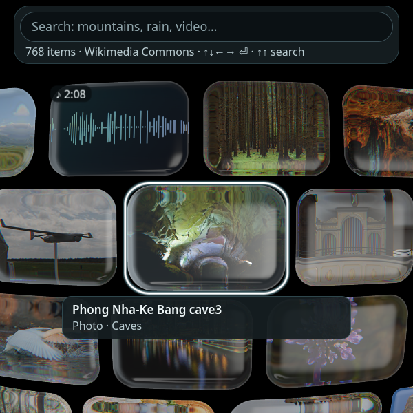
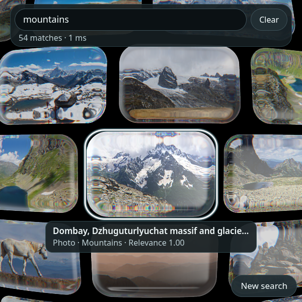
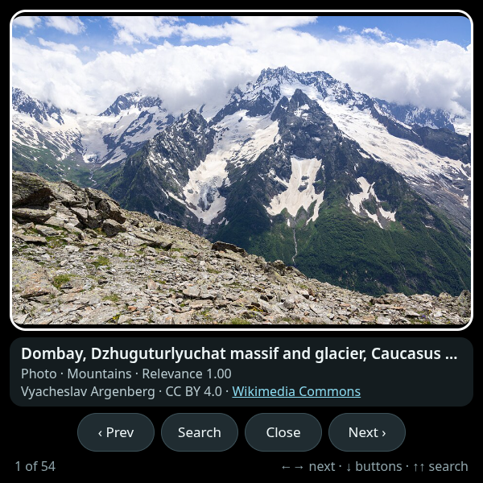
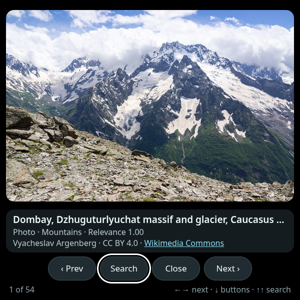
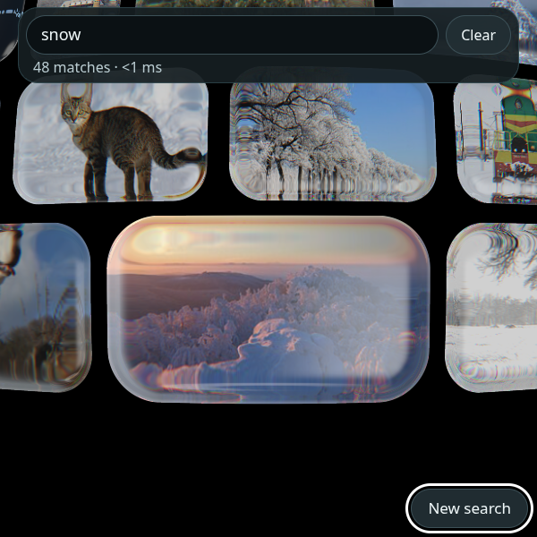

# Glass Mosaic

**An almost infinite, mixed-media liquid-glass mosaic, searched with real
in-browser capabilities. Built for Meta Ray-Ban Display glasses.**

Glass Mosaic is a Web App for the 600 × 600 display of Meta Ray-Ban Display
(MRBD). It shows 768 Wikimedia Commons photos, videos and sound recordings as
refractive glass cards on a curved field that repeats in every direction. Type
or dictate a query and the mosaic rearranges into a spiral around the best
matches, each card scored by relevance. Everything runs in the browser: a
WebGL2 renderer, a BM25 index built at build time, and no models, no WebGPU
and no hosted inference.

| Mosaic | Search “mountains” | Viewer |
| --- | --- | --- |
|  |  |  |

| Viewer: Search button | Results: New search |
| --- | --- |
|  |  |

The screenshots are from headless Chromium at 600 × 600, driven only by arrow
keys and Enter (`npm run test:e2e`). On the glasses, black is transparent.

## Controls (arrows + Enter only)

| Where | Keys | What happens |
| --- | --- | --- |
| Mosaic | ← → ↑ ↓ | Move focus to the neighbouring card. The camera pans to follow, without end left, right and down. |
| Mosaic | Enter | Open the focused card in the viewer. |
| Mosaic, top row | ↑ | Go to the search field. |
| Anywhere | ↑ ↑ (twice within 350 ms) | Jump to the search field and open the composer. The first ↑ still moves normally; only the second is consumed. Not from the field itself. |
| Search field | Enter / select | Opens the system composer (handwriting, dictation, keyboard). Committed text searches. |
| Search field | ↓ | Back to the mosaic. → at the end of the text reaches **Clear**. |
| Viewer | ← → | Previous / next result (or neighbouring card while browsing). |
| Viewer | Enter | Play / pause video and sound. |
| Viewer | ↓ | The button row: Prev · **Search** · Play · Close · Next. Search is one ← from where ↓ lands; it closes the viewer (via history, like Close) and opens the composer. |
| Results, bottom row | ↓ | **New search** button (bottom right). Enter opens the composer; ↑ returns to the cards. |
| Anywhere (experimental) | Wrist twist ≥ 50° and back (Meta Neural Band) | Opens search. See below. |
| Anywhere | Back (system) | Closes the viewer, then clears the search, then leaves the app. |

Every "open search" path does the same thing: close the viewer if it is open,
focus the semantic `<input type="search">` and activate it (`click()`), which
is what opens the system composer. Committed text comes back through `input`
and `change` only, and both run the search.

**Wrist twist (experimental).** On glasses whose runtime exposes the Meta
Neural Band as `RelativeOrientationSensor({ sensorId: 'emg-wrist' })`
([Wrist orientation docs](https://wearables.developer.meta.com/docs/develop/webapps/build/wrist/)),
a quick forearm twist of at least 50° in either direction and back within
1.2 s opens search. Hysteresis: it fires on the return under 20°; cooldown
1.5 s. Roll is measured as an offset from a reference captured only after the
readings are stable for 1 s (after a 1 s warm-up), so the early frame flip
while the runtime learns the wrist is ignored. The reference follows slow drift
and re-captures after a held posture change. Detection uses the runtime's
`__imuQuatWrapped` marker, as the docs require, so desktop Chromium's own
`RelativeOrientationSensor` is never used. It is on by default only when that
sensor exists; `?wrist=0` turns it off (remembered), `?wrist=1` turns it back
on. A small dim "⟲ twist: search" hint shows while it is active. The sensor is
stopped while the page is hidden. Tunables are in `src/app/wrist.ts`
(`WRIST_DEFAULTS`) and `src/app/doubletap.ts` (`DOUBLE_ARROW_UP_MS`).

The app uses browser history for Back, as the docs recommend: opening the
viewer and committing a search each add one entry (at most 3 in total, under
the host's limit of 5). Popping state never pushes new entries.

Spatial navigation is handled by the browser everywhere except inside the card
field and the viewer. There, arrow keys move between cards that are drawn on a
canvas and reflowed while the camera moves, which the browser cannot score.
Those widgets call `preventDefault()` only for the arrows they handle, and each
one has an exit: ↑ from the top row, ↓ to the buttons, and Back. The e2e suite
runs twice, once in plain desktop Chromium and once with
`--enable-spatial-navigation`, which is how the glasses' browser behaves.

## Run it locally

Requirements: Node 20.19+ (see `.nvmrc`). ffmpeg is needed only to rebuild the
catalog.

```bash
npm install
npm run dev            # http://localhost:5173 (builds the search index first)
npm run build          # typecheck + production build in dist/
npm run preview        # serves dist/ on http://localhost:4173
```

Useful URL parameters:

| Parameter | Effect |
| --- | --- |
| `?reduced=1` | Reduced mode: no live video previews, no camera easing, DPR 1, fewer results. Also turns on with `prefers-reduced-motion`, or by itself when frames are consistently slow. `?reduced=0` forces it off. |
| `?render=dom` | DOM fallback with plain images instead of WebGL. Also used automatically when WebGL2 is missing or the context is lost. |
| `?wrist=0` / `?wrist=1` | Turn the experimental wrist-twist gesture off / on (remembered in `localStorage`). |
| `?debug=1` | Keep the diagnostics line visible: `WebMCP: unavailable` or `WebMCP: N tools` (from `document.modelContext.getTools()`, plus any registration errors) and `Wrist: on / off / unavailable`; with `?debug=1` it also lists the tool names. Without it the line shows for about 4 s at launch. |
| `?seed=42` / `?seed=math` | Shuffle seed for the mosaic order. The default is fixed so screenshots are reproducible. |

### Checks

```bash
npm run typecheck
npm run lint
npm test               # Vitest: ranker, text/stemming, fuzzy, synonyms, indexer, catalog, layout, neighbours, WebMCP, double-↑, wrist roll
npx playwright install chromium   # once
npm run test:e2e       # Playwright at 600x600, arrows + Enter only (needs network for Wikimedia media)
npm run verify         # all of the above
```

The Playwright tests set the field's value and fire `input` and `change`, the
only events the glasses' composer delivers. They use `page.goBack()` for the
system Back gesture. The main test also fails on any request for a model,
ONNX, embedding or HDR file, or to any host other than the app and
`upload/thumb.wikimedia.org`.

## Preview with the Meta Ray-Ban Display Simulator

1. Install the [Meta Ray-Ban Display Simulator](https://chromewebstore.google.com/detail/jpjlmmodokemlepklkdbimceggpbjcll) Chrome extension.
2. Open `http://localhost:5173` (or your HTTPS deployment) in Chrome, then click the extension icon to turn the simulator on.
3. Use its D-pad and Select buttons, or your keyboard's arrow keys and Enter. Try it over the built-in scenes with additive blending turned on.
4. Run its quality checklist: viewport meta, favicon, focus targets, overflow and focus styles.
5. **View on Glasses QR** creates the install QR code for your own glasses (see below).

For a quick check without the extension, start Chrome with
`--enable-spatial-navigation` in a separate profile.

## Deploy (static HTTPS)

`dist/` is a fully static site with relative URLs (`base: './'`), so it works
at a domain root or under a sub-path such as `https://<user>.github.io/glass-mosaic/`.
It must be served over HTTPS. Keep `dist/.well-known/meta-wearables-manifest.json`:
the glasses read the app name and icon from it.

### GitHub Pages

`.github/workflows/pages.yml` runs typecheck, lint, unit tests and the build on
every push to `main`, then deploys `dist/`:

1. Push the repository to GitHub.
2. In **Settings → Pages**, set **Source** to **GitHub Actions**.
3. Push to `main`, or run the workflow by hand.

The workflow passes `include-hidden-files: true` to
`actions/upload-pages-artifact`. Without it, the `.well-known` directory would
be left out of the artifact.

### Azure Static Web Apps

`.github/workflows/azure-static-web-apps.yml` runs manually and uploads the
prebuilt `dist/` (`skip_app_build: true`):

1. Create a Static Web App (Free plan is enough) with **Deployment source: Other**.
2. Copy its deployment token into the repository secret `AZURE_STATIC_WEB_APPS_API_TOKEN`.
3. Run **Deploy to Azure Static Web Apps** from the Actions tab.

`public/staticwebapp.config.json` serves JSON as `application/json; charset=utf-8`
and sets cache headers. After the first deploy, check that
`https://<app>/.well-known/meta-wearables-manifest.json` returns 200.

## Load it on the glasses

Setup: Meta AI app v272 or later, with **Developer Mode** on. To turn it on,
open the Meta AI app → **Settings** → **App Info**, tap the **App version**
number five times, then tap **Enable**.

**From the Meta AI app**

1. Tap **App Settings** → **Apps** → **Web Apps** → **Connect Web App**.
2. Enter the HTTPS URL, e.g. `https://<user>.github.io/glass-mosaic/`. Use a trailing slash so the manifest resolves to `…/glass-mosaic/.well-known/meta-wearables-manifest.json`.
3. Tap **Save**. Glass Mosaic appears at the bottom of the app grid on the glasses.

**With a QR code**

Use **View on Glasses QR** in the simulator to generate the install QR for the
deployed URL. The link format is
`fb-viewapp://web_app_deep_link?appName=Glass%20Mosaic&appUrl=<https-url>`.
A plain QR code of the site URL is not recognized, and HTTP URLs are rejected.

Middle-tap on the glasses opens the system menu (Restart, Resume, Permissions).

## How search works

There are no embeddings and no model. Search is classic information retrieval
that runs in a few milliseconds on the main thread.

- **Build time** (`scripts/build-index.ts`, run automatically before `dev` and
  `build`): each catalog item's title, topic, tags, description and artist are
  normalized (NFKD, accents stripped, lower-cased), split into words, filtered
  for stopwords, and stemmed (light English rules: plurals, `-ies`, `-ing`,
  `-ed`, plus irregulars such as wolves → wolf). A BM25F inverted index with
  field weights (title 3, topic 2.5, tags 2, description 1, artist 0.5;
  k1 = 1.2, b = 0.75) is written to `public/data/search-index.json` (6,213
  terms, 219 KiB, 80 KB gzipped). If it is missing or stale, the app builds
  the same index in the browser.
- **Query time** (`src/search/ranker.ts`): each query word expands to
  - the exact term (weight 1);
  - hand-curated synonyms (0.6, e.g. *sea ↔ ocean*, *peak ↔ mountain*, *kitty ↔ cat*);
  - vocabulary prefixes found by binary search over the sorted terms (up to 0.8, so results appear while typing);
  - fuzzy matches by bounded Damerau–Levenshtein distance (1 edit for 4–6 letters, 2 for 7+; 0.55 / 0.30), used only when nothing else matches.

  All expansions of a word share the exact term's IDF, so a rare near-miss
  (e.g. *massif* for *mountains*) cannot outrank a real match. Documents that
  match more of the query words score higher. Media words (*photo*, *video*,
  *clip*, *sound*, *recording* …) are treated as intent: they boost that type
  ×1.35 and dampen the others ×0.7, so *rain sounds* puts recordings first.
- **Relevance** (shown on cards and in the viewer) runs from 0 to 1. It is
  match quality (1 for exact, less for prefix, synonym or typo matches) ×
  √(score ÷ best score).
- **Layout**: the hits (up to 60, or 40 in reduced mode) are placed on a spiral
  centred on the best match, with opacity scaled by relevance. The original
  mosaic comes back with Clear or Back.

Typing previews results after 250 ms without moving focus. A committed query
(the composer's `change`, or Enter) also moves focus to the best match.

## WebMCP agent tools (BETA, off by default)

> **Beta:** WebMCP on MRBD is only available in Developer Mode / the beta
> rollout and is **off by default**. The glasses decide at launch whether a page
> may offer tools. The API may change.

When `document.modelContext` exists, the app registers six tools right at
launch, before the catalog loads, because eligibility is decided when the app
launches. Until the mosaic is ready, a call returns a short "still loading"
result. Without `document.modelContext`, nothing happens.

| Tool | Input | Annotations | Effect |
| --- | --- | --- | --- |
| `mosaic_get_state` | none | `readOnlyHint`, `idempotentHint` | Reads the screen (`mosaic` / `results` / `viewer`), the current query and match count, and the focused or open item's title, type and position. Registered first. |
| `mosaic_search` | `{ query: string }` | `idempotentHint` | "show me X", "find X", "search for X in the mosaic": runs the same search as the field and returns the count and the top 5 titles with positions. |
| `mosaic_open_item` | `{ position?: number }` | | Opens result *n* (1-based), or the focused card if no position is given. |
| `mosaic_next_item` / `mosaic_previous_item` | none | | Steps in the viewer, or moves focus in the mosaic. |
| `mosaic_close_viewer` | none | `idempotentHint` | Closes the viewer. |

The setup copies Meta's official samples,
[facebook/meta_glasses_webmcp](https://github.com/facebook/meta_glasses_webmcp)
(`examples/todo`, `examples/market`), and the
[`ai-glasses-webapp-webmcp` skill](https://github.com/facebook/meta-wearables-webapp/blob/main/plugins/meta-wearables-webapp/skills/ai-glasses-webapp-webmcp/SKILL.md):

- **Instruction in the document head.** `<title>` carries the standing rule
  ("Glass Mosaic — Always act with a mosaic_* tool: … Never answer with a
  description of what you would do."), and `src/app/title.ts` appends the live
  screen on every screen change, like the Todo sample's `view.ts`.
  `<meta name="description">` repeats the guidance, like the Market sample. The
  visible UI does not change, and the launcher name still comes from
  `.well-known/meta-wearables-manifest.json`.
- **Persona file.** `public/llms.txt` (with the same text in `public/agent.md`)
  describes the screens, the tools and example phrases.
- **Results Meta AI can steer on.** Every result is JSON with a `next_action`.
  Handled conditions (no matches, a position out of range, still loading) come
  back as `{ error: true, message, next_action }` rather than as a thrown error
  or an `isError` flag, which the skill says is dropped.
- **Guarded registration.** One `safeRegister` call per tool copes with a
  synchronous throw and with a promise, a handle or nothing as the return value.
  Only scalar parameters are used. There is no `untrustedContentHint`, since the
  samples use only `readOnlyHint` / `idempotentHint`; catalog titles are still
  sanitized.

Every tool works on every screen, so none has to be unregistered when the view
changes. With `?debug=1` the diagnostics line lists the registered tool names.
To disable the tools, remove the `registerAgentTools` call in `src/app/main.ts`.

## What came from embed-anything, and what did not

This app is a standalone port of
[forcewake/embed-anything](https://github.com/forcewake/embed-anything) (MIT).

**Ported**

- the WebGL2 instanced liquid-glass renderer and its GLSL 300 ES shaders (unchanged);
- the curved-field geometry, the mosaic layout and spiral result layout, and the spatial index;
- a slimmer media texture pool;
- catalog normalization, waveform painting and the seeded shuffle;
- the viewer (rewritten for arrows and Enter);
- the DOM fallback.

**Changed for the glasses**

- at most 160 instances and 48 texture layers of 320 × 240;
- the focused texture capped at 1024 px;
- DPR capped at 1.5 (1 in reduced mode);
- a low-power WebGL context;
- one muted 240p WebM preview for the focused video only, at 12 fps, paused when the page is hidden;
- a procedural studio environment instead of downloading `studio.hdr`;
- focusable DOM buttons layered over the canvas, so focus, `:focus-visible`, Enter and screen-reader labels behave like ordinary controls.

**Dropped**

- EmbeddingGemma 2, Transformers.js and the ONNX/WebGPU worker;
- the f16 embedding matrices and every asset fetch step;
- the reference and fidelity tooling and the ML e2e tests;
- the "w/ EmbeddingGemma 2" branding;
- camera, microphone, file upload and drag-and-drop queries.

**Catalog.** embed-anything's catalog depended on the Hugging Face Space
bundle. Its `build-catalog.mjs` parses manifests out of the Space's deployed
JavaScript, and `fetch-assets.mjs` downloads the matrices, ORT and the HDR file
from the Space. Glass Mosaic does not use any of that. `npm run catalog:build`
(`scripts/build-catalog.mjs`) builds a new catalog from the public Wikimedia
Commons API:

- 40 photo topics, 14 video topics and 18 sound topics;
- WebM/VP9 video derivatives only, so they play in Chromium;
- 64-bar loudness waveforms computed with ffmpeg.

The resulting `public/data/catalog.json` (768 items, 781 KiB, 150 KB gzipped)
is committed, so normal builds need no network. If you already have a legacy
embed-anything catalog file, `npm run catalog:import-legacy -- <file>` converts
it offline. That step is optional and kept separate, and it never downloads
anything.

## Project layout

```
src/
  app/        main.ts (wiring, history, modes) · toolbar.ts · viewer.ts · webmcp.ts
  engine/     GlassRenderer · GlassField · MediaPool · layout · spatial index · geometry · shaders/
  media/      catalog normalization · waveform · shuffle · types
  search/     text (normalize/stem) · synonyms · fuzzy · indexer (BM25F) · ranker
  styles/     app.css (additive-display rules)
public/       data/catalog.json · icon.svg · favicon.svg · .well-known/meta-wearables-manifest.json
scripts/      build-catalog.mjs · build-index.ts · import-legacy-catalog.ts
tests/        Vitest unit tests      e2e/  Playwright (600x600, arrows + Enter)
```

**Why not `@wearables-ui-toolkit/mrbd`?** It is a React component library, and
its focus provider manages spatial focus for its own components. This app is
framework-free (69 KiB of JS), and its main surface is a WebGL canvas with a
custom focus model, so the toolkit would add weight and a second focus system.
The app follows the same display rules instead: a black background, bounded
dark surfaces, text of at least 16 px, clear focus rings, and a monochrome
manifest icon.

## Build and asset sizes

Measured on the production build:

| File | Size | Gzipped |
| --- | ---: | ---: |
| `assets/index-*.js` (app, renderer, shaders, search) | 69 KiB | 24 KB |
| `assets/index-*.css` | 5 KiB | 1.5 KB |
| `data/catalog.json` | 781 KiB | 150 KB |
| `data/search-index.json` | 219 KiB | 80 KB |
| **Total `dist/`** | **≈1.1 MB** | **≈260 KB** |

Media are loaded on demand from Wikimedia: 330 px thumbnails for cards, 960 px
images in the viewer, 240p WebM previews and 360p/480p WebM video, and MP3/Ogg
audio.

## Limitations

- **Not yet tested on real glasses.** It has been checked in desktop Chromium,
  in Chromium with spatial navigation, and in headless SwiftShader WebGL. Still
  unknown on the device: GPU frame rate and thermals, WebGL2 texture-array
  limits, video decode, autoplay, and how the composer commits text.
  Reduced mode and the DOM fallback are there as safety nets. Slow frames
  switch on reduced mode automatically.
- **Network required.** The media are hot-linked from Wikimedia, so there is no
  offline mode. Commons may throttle heavy use. Use the API politely and keep
  the identifying User-Agent in the build script.
- **Bright media.** The glass field is dimmed (unfocused cards are drawn at
  72 % opacity, and search results at 50–85 % by relevance), but photos are
  still photos. A bright image is bright on an additive display.
- **Search is lexical.** It handles synonyms, prefixes and typos, but not
  meaning: *serene* will not find *calm lake* unless a synonym or a tag
  connects them. The synonym list is hand-curated (≈55 groups, English only).
- **Spatial navigation.** The field and viewer handle arrow keys themselves.
  Arrows behave the same with and without Chromium spatial navigation, but the
  real device's focus rules should still be checked by hand.
- **WebMCP** is beta, off by default, and only feature-detected; it was tested
  against a stand-in, not the real runtime. If "Hey Meta, search the mosaic…"
  does nothing, open the app with `?debug=1`: `WebMCP: unavailable` means
  `document.modelContext` is missing (WebMCP is not enabled on the device:
  Developer Mode or rollout, then restart the glasses and the Meta AI app).
  `getTools()` only reflects this page's registry, not what the assistant sees.
  `WebMCP: 6 tools` with Meta AI still never calling them matches the open
  [meta-wearables-webapp#31](https://github.com/facebook/meta-wearables-webapp/issues/31),
  where even the official Todo sample was not invoked. That suggests a
  platform-side cause that this app cannot fix.
- **Wrist twist** is experimental and was tested only with a stand-in sensor.
  Thresholds, the stream rate, how the sensor permission prompt looks at
  launch, battery cost of continuous streaming, and whether a programmatic
  `click()` from a sensor event (no user activation) opens the composer are
  unverified on hardware. If it does not, the field is still focused and Enter
  opens the composer.

## Licensing

- **Code:** MIT. See [`LICENSE`](LICENSE), which keeps the embed-anything
  notice. [`NOTICE.md`](NOTICE.md) lists the files that came from
  embed-anything and how each was changed.
- **Provenance caveat:** embed-anything says its shaders and some renderer math
  were recovered byte-for-byte from the Hugging Face Space's deployed bundle,
  which has no known open-source license. Before any commercial or high-stakes
  public release, read `NOTICE.md` and consider replacing the shaders with a
  clean-room version.
- **Media:** none is in the repository. The catalog lists Wikimedia Commons
  files, each under its own free license: mostly CC BY-SA, plus CC BY, CC0,
  public domain and a few GFDL/FAL. The viewer shows each item's author,
  license and a link to its Commons page. Attribution and share-alike apply if
  you reuse the media elsewhere.
- No model weights, embeddings or third-party fonts are included or downloaded.
